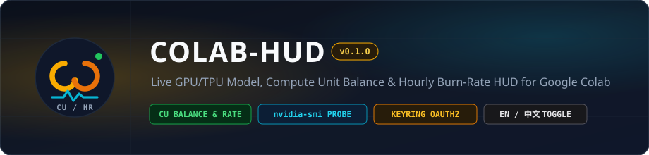

<div align="center">



<p>
  <strong>Monitor en tiempo real de modelo GPU/TPU, saldo de Compute Units y tasa de consumo por hora para Google Colab</strong>
</p>

<p>
  <a href="LICENSE"></a>
  
  
  
  
  
</p>

<p>
  <a href="README.md">English</a> ·
  <a href="README.zh-CN.md">简体中文</a> ·
  <a href="README.ja.md">日本語</a> ·
  <a href="README.ko.md">한국어</a> ·
  <strong>Español</strong> ·
  <a href="README.fr.md">Français</a> ·
  <a href="README.de.md">Deutsch</a> ·
  <a href="README.ru.md">Русский</a>
</p>

<p>
  <a href="#overview">Descripción</a> ·
  <a href="#quick-start">Inicio rápido</a> ·
  <a href="#data-sources">Fuentes de datos</a> ·
  <a href="CHANGELOG.md">Historial de cambios</a>
</p>

</div>

---

<div align="center">
  
</div>

---

## <a id="overview"></a>Descripción

**COLAB-HUD** es una píldora flotante de escritorio, herramienta CLI y plugin de panel lateral para Antigravity 2.0 diseñado para Google Colab. Utiliza las credenciales OAuth2 guardadas por `google-colab-cli` en el llavero del sistema —sin bloquear el sondeo en segundo plano esperando entrada estándar— para mostrar el hardware GPU/TPU/CPU activo, la tasa de consumo (`CU/hr`), el saldo restante, el tiempo estimado y el correo de la cuenta conectada.

### Características principales

- **Saldo de CU, consumo por hora y cuenta activa**: Consulta `/tun/m/ccu-info` y `/tun/m/assignments` y almacena en caché `userinfo.email` para identificar de un vistazo qué cuenta de Google está conectada.
- **Sondeo `nvidia-smi` bajo demanda**: Obtiene el acelerador y forma de máquina (`Standard` / `High-RAM`) al instante, comprueba `/api/kernels` en solo lectura y —al pulsar **Probe GPU** o ejecutar `--probe`— obtiene el modelo exacto de GPU, VRAM, RAM, vCPU y uso de disco en caché por endpoint.
- **Diálogo OAuth integrado**: Abre automáticamente el inicio de sesión de Google en tu navegador y guarda el código en el llavero oficial del sistema.

---

## <a id="quick-start"></a>Inicio rápido

```bash
uv tool install git+https://github.com/googlecolab/google-colab-cli.git
```

### 1. Plugin de panel lateral para Antigravity 2.0

```bash
python plugin/install_plugin.py
python plugin/install_plugin.py --uninstall
```

### 2. Ventana flotante y CLI

```bash
python -m desktop.cli                 # Píldora flotante
python -m desktop.cli --cli           # Resumen único en terminal
python -m desktop.cli --json          # Salida JSON estructurada
python -m desktop.cli --probe --force # Sondear GPU exacta / VRAM / RAM
python -m desktop.cli --watch         # Monitor continuo
```

En Windows, haz doble clic en `desktop/launch.bat` o `desktop/launch.pyw`.

---

## <a id="data-sources"></a>Fuentes de datos

| Fuente | Endpoint / Método | Datos obtenidos |
| :--- | :--- | :--- |
| Colab Session API | `GET /tun/m/ccu-info` | Saldo CU, tasa por hora y asignaciones activas |
| Colab Assignments API | `GET /tun/m/assignments` | Acelerador, perfil de máquina y proxy de runtime |
| Runtime Proxy | `GET {proxy_url}/api/kernels` | Conteo de kernels y estado (`idle` / `busy` / `none`) |
| Runtime Probe | `ColabRuntime.execute_code(...)` | Modelo exacto `nvidia-smi`, VRAM, RAM, vCPU y disco |
| Google OAuth2 | `GET /oauth2/v2/userinfo` | Correo de la cuenta conectada |

---

## Licencia

Distribuido bajo la [Licencia MIT](LICENSE).
