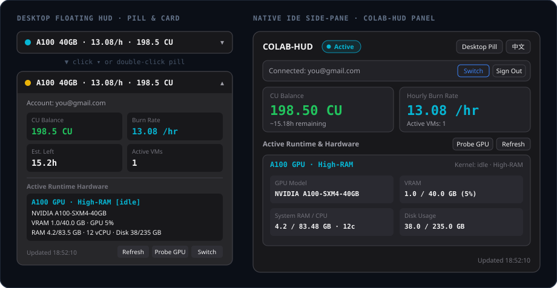

<div align="center">


<p>
  <strong>适用于 Google Colab 的硬件型号、算力点数余额与每小时消耗费率实时监控工具</strong>
</p>

<p>
  <a href="LICENSE"></a>
  
  
  
  
  
</p>

<p>
  <a href="README.md">English</a> ·
  <strong>简体中文</strong> ·
  <a href="README.ja.md">日本語</a> ·
  <a href="README.ko.md">한국어</a> ·
  <a href="README.es.md">Español</a> ·
  <a href="README.fr.md">Français</a> ·
  <a href="README.de.md">Deutsch</a> ·
  <a href="README.ru.md">Русский</a>
</p>

<p>
  <a href="#overview">功能介绍</a> ·
  <a href="#quick-start">快速开始</a> ·
  <a href="#data-sources">数据源与接口说明</a> ·
  <a href="CHANGELOG.md">更新日志</a>
</p>

</div>

---

<div align="center">
  
</div>

---

## <a id="overview"></a>功能介绍

**COLAB-HUD** 是一款轻量级的 Google Colab 桌面悬浮监控胶囊、命令行工具与 Antigravity 2.0 侧边栏插件。它直接复用本机 `google-colab-cli` 保存在系统凭据管理器（keyring）中的 OAuth2 凭据，在后台轮询时永不阻塞 `stdin`，帮助你随时掌握当前分配到的 GPU/TPU/CPU 详细硬件型号、每小时点数消耗费率（`CU/hr`）、剩余 Compute Units 余额、预计剩余可用时间以及当前授权连接的 Google 账号邮箱。

### 主要特性

- **点数余额、烧钱速率与账号防呆显示**：轮询 Colab 官方会话接口 `/tun/m/ccu-info` 与 `/tun/m/assignments`，展示实时余额、每小时耗点速率（`CU/hr`）、预计还能跑多久（`余额 / 速率`）、活跃实例数以及通过 `userinfo.email` 缓存的当前绑定邮箱，防止多账号切换时连错号。
- **按需探测 `nvidia-smi` 精确显卡型号**：无需启动额外内核即可直接读取后端返回的加速器型号（`T4` / `L4` / `G4` / `A100` / `H100` / TPU / CPU）与内存规格（`Standard` / `High-RAM`），并只读检查 Jupyter `/api/kernels` 的运行状态（`idle` / `busy` / `none`）；仅当你主动点击**探测显卡**或执行 `--probe` 时，才会在对应实例上执行只读硬件探测以获取具体 GPU 型号（例如 `NVIDIA A100-SXM4-40GB`）、显存占用、GPU 利用率、系统内存、vCPU 核心数与磁盘占用，结果按 `endpoint` 缓存。
- **无阻塞鉴权与内置浏览器引导弹窗**：后台刷新仅加载并静默续期已存凭证；当未登录或需切号时，内置授权对话框会自动在浏览器打开 Google 登录授权页，粘回页面上的授权码即可保存至系统 keyring。
- **悬浮窗内直选全套官方配置并开机/关停**：可在桌面胶囊展开卡片、右键菜单或侧边栏面板里直接选择全部 13 种官方支持的硬件配置组合（`CPU`、`T4`、`G4`、`A100`、`H100` 的标准/高内存版，单规格 `L4`，以及 `TPU v5e-1` / `TPU v6e-1`），一键分配开机（`/tun/m/assign`）、跳转 Colab 网页直连该机器，或随时安全关停单个/全部活跃实例（`/tun/m/unassign`），并同步写入 `google-colab-cli` 本地会话列表。
- **桌面悬浮胶囊、CLI 与侧边栏插件三合一**：桌面端无边框 Tkinter 悬浮胶囊（`launch.bat` / `launch.pyw`）会在底部展开时自动上移避让任务栏；Antigravity 侧边栏插件（`sidecars/colab_panel/`）自动适配 IDE 明暗主题，并支持一键从侧边栏唤起桌面悬浮胶囊。
- **自动复用 `google-colab-cli` 环境**：无论从系统 Python 还是 Node.js 侧边栏启动，都会自动定位 `uv` 工具环境下的 `google-colab-cli` `site-packages` 与 `pythonw.exe`，无需重复装库。

---

## <a id="quick-start"></a>快速开始

### 前置条件

若尚未安装官方 `google-colab-cli`，先安装一次即可：

```bash
uv tool install git+https://github.com/googlecolab/google-colab-cli.git
```

### 1. Antigravity 2.0 侧边栏插件

一键将自带 Python 遥测后端的插件复制到 `~/.gemini/config/plugins/colab-hud`，随后在 Antigravity 插件管理器中开启 `colab-hud`：

```bash
python plugin/install_plugin.py
```

卸载插件：

```bash
python plugin/install_plugin.py --uninstall
```

### 2. 独立桌面悬浮胶囊与命令行工具

完全独立运行，不依赖任何 IDE 插件：

- **Windows 桌面静默启动（无控制台黑框）**：双击 `desktop/launch.bat` 或 `desktop/launch.pyw`
- **Python 图形界面 / 命令行**：

```bash
# 启动桌面悬浮胶囊（默认中文界面，10s 轮询，94% 透明度）
python -m desktop.cli

# 可选参数：--lang zh|en，--interval 10，--refresh-ms 1000，--alpha 0.94
python -m desktop.cli --lang en --interval 5

# 在终端打印一次当前状态摘要后退出
python -m desktop.cli --cli

# 输出结构化 JSON 快照（加上 --no-kernel-check 可跳过 /api/kernels 查询）
python -m desktop.cli --json

# 对当前活跃实例执行精确 GPU / VRAM / RAM / CPU / 磁盘探测
python -m desktop.cli --probe --force

# 列出全部 13 种官方预设配置、启动指定显卡实例或关停所有实例
python -m desktop.cli --presets
python -m desktop.cli --start a100_hm
python -m desktop.cli --stop-all

# 在终端持续刷新监控输出
python -m desktop.cli --watch --interval 10
```

> [!TIP]
> 左键按住胶囊顶部可拖动位置（锁定后固定），点击 `▾` 或双击胶囊文字可展开/收起详情卡片；在窗口任意位置**点击鼠标右键**即可切换 **语言（`中文` / `EN`）**、**授权登录 / 切换账号**、**探测精确显卡**、**置顶显示**、**锁定位置**、**透明度（`100%`–`70%`）** 与 **刷新间隔（`5s`–`60s`）**。

---

## <a id="data-sources"></a>数据源与接口说明

| 数据来源 | 接口 / 方式 | 读取内容 |
| :--- | :--- | :--- |
| Colab 会话后端 | `GET /tun/m/ccu-info` | 当前 CU 点数余额（`currentBalance`）、每小时消耗速率（`consumptionRateHourly`）、活跃实例数（`assignmentsCount`） |
| Colab 实例分配接口 | `GET /tun/m/assignments` | 当前各运行实例的加速器代号（`T4` / `L4` / `G4` / `A100` / `H100` / `V5E1` / `V6E1` / `NONE`）、内存形态（`Standard` / `High-RAM`）与代理凭证 |
| 实例代理只读查询 | `GET {proxy_url}/api/kernels` | 当前运行中内核数量与执行状态（`idle` / `busy` / `none`），不新建内核 |
| 按需硬件探测 | `ColabRuntime.execute_code(...)` | 通过 `nvidia-smi`、`/proc/meminfo`、`os.cpu_count()` 与 `shutil.disk_usage("/")` 获取精确显卡型号、显存、内存、vCPU 与磁盘用量 |
| Google 用户信息 | `GET /oauth2/v2/userinfo` | 当前授权连接的 Gmail 邮箱（按凭证指纹缓存在本地） |

---

## 项目目录结构

```text
colab-hud/
├── desktop/                     # 桌面悬浮胶囊、内置 OAuth 弹窗与 CLI
│   ├── telemetry.py             # 无阻塞凭据加载、Colab 接口轮询、/api/kernels 与 nvidia-smi 探测
│   ├── hud_pill.py              # Tkinter 无边框悬浮胶囊、详情卡片与 OAuth 引导弹窗
│   ├── cli.py                   # GUI / --cli / --json / --watch / --probe / --oauth-prompt 入口
│   ├── launch.pyw               # Windows 无黑框 GUI 启动入口
│   ├── launch.bat               # Windows 双击启动脚本
│   └── assets/colab_hud.ico     # 桌面快捷方式图标
├── plugin/                      # Antigravity 2.0 侧边栏插件
│   ├── plugin.json              # 插件清单文件
│   ├── install_plugin.py        # 自包含安装 / 卸载脚本
│   ├── assets/logo.svg          # 插件图标
│   └── sidecars/colab_panel/    # sidecar_sdk Node 后端（5 秒缓存 + ETag）与前端面板
├── tests/                       # 遥测、OAuth 流程与 CLI 单元测试
├── docs/assets/                 # SVG 横幅与界面预览图
├── pyproject.toml
├── CHANGELOG.md
└── LICENSE
```

---

## 开源协议

基于 [MIT License](LICENSE) 开源发布。
